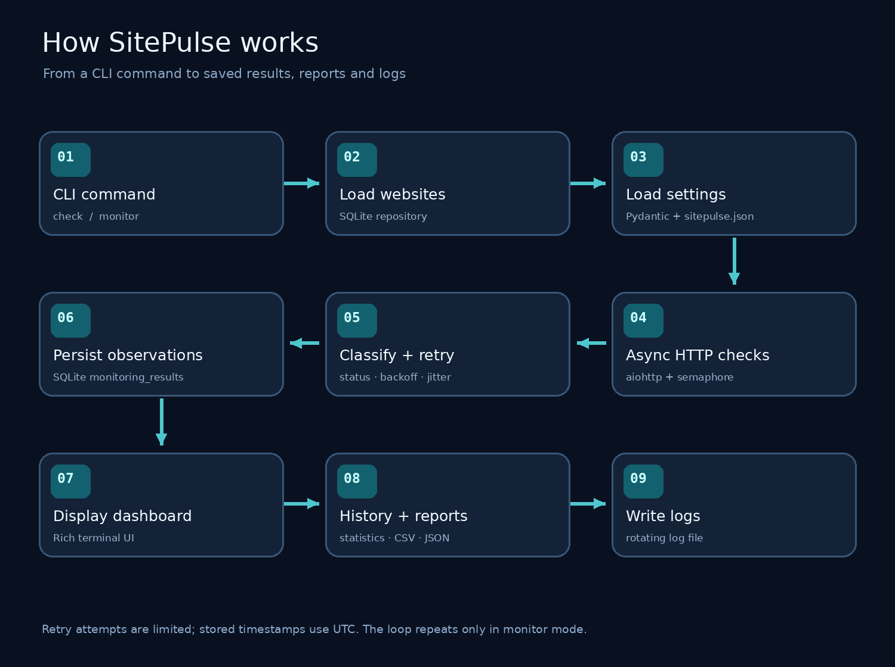
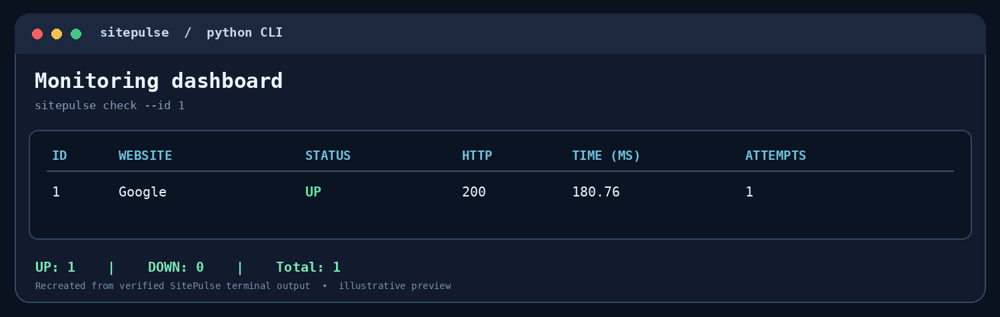
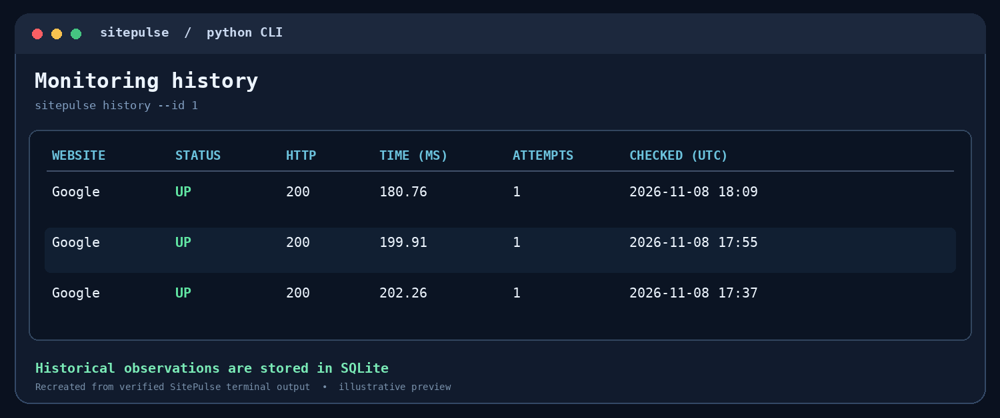
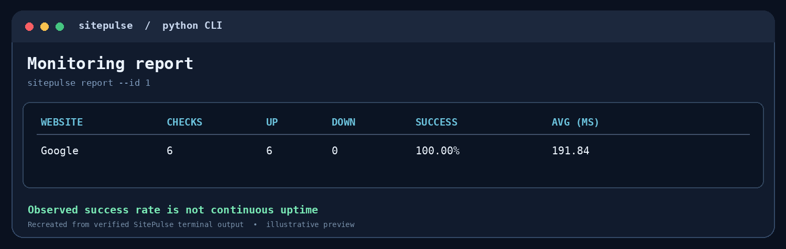

<div align="center">

# SitePulse

### Intelligent Asynchronous Website Monitoring System

**A Python-powered command-line tool for monitoring website health, recording check history, and turning observations into actionable reports.**

[](https://www.python.org/)


[**Getting started**](#getting-started) · [**How it works**](#how-sitepulse-works) · [**User guide**](#complete-user-guide) · [**Architecture**](#project-architecture--folder-structure) · [**Author**](#author)

</div>

---

## About SitePulse

Keeping a website online is important, but manually checking its status is inconvenient and unreliable. **SitePulse** solves this by making repeatable HTTP checks, recording their outcomes, and showing a clear picture of how monitored sites are behaving over time.

Instead of requiring a server or cloud account, SitePulse runs locally in a terminal. Users can register several websites, run checks concurrently, configure retry and timeout policies, review stored history, and export reports. It is suitable for developers, students, small personal projects, and anyone who wants a lightweight introduction to practical monitoring.

**What SitePulse can do**

| Monitoring | Storage & analysis | Reliability & developer experience |
|---|---|---|
| Check many enabled sites concurrently | Save checks in SQLite | Retry transient failures with backoff |
| Show UP/DOWN and HTTP status | Browse historical observations | Configure timeouts and concurrency |
| Measure check duration and attempts | Calculate observed success percentage | Recover corrupted settings from a backup |
| Repeat checks at a chosen interval | Export summary reports to CSV/JSON | Rotate logs; test with pytest, Ruff and mypy |

> [!NOTE]
> SitePulse is a **local CLI**, not a hosted service. It monitors only while its command is running. A result marked **UP** means the configured HTTP success criteria were met at the moment of that check; it does not prove uninterrupted availability.

### Technology stack

| Layer | Technology | Role |
|---|---|---|
| Language | Python 3.12+ | Typed application code |
| Concurrency | `asyncio` | Run I/O-bound checks cooperatively |
| HTTP client | `aiohttp` | Make asynchronous HTTP requests |
| CLI | Typer | Commands, options and help |
| Terminal UI | Rich | Readable status and reporting tables |
| Validation | Pydantic | Validate persistent settings |
| Database | SQLite + `aiosqlite` | Store websites and check history |
| Logging | Python `logging` | Console logging and rotating log files |
| Quality | pytest, pytest-asyncio, Ruff, mypy | Regression tests, linting and type checks |

---

## Core concepts and theoretical background

These terms explain **why** SitePulse is designed the way it is and **what** its results mean.

| Term | Simple explanation | Use inside SitePulse |
|---|---|---|
| **Website monitoring** | Checking whether a website responds as expected at specific times | Each check produces an UP or DOWN observation |
| **HTTP** | The request/response protocol used by websites | SitePulse sends requests and inspects response status codes |
| **HTTP status code** | A number describing the server response, such as `200`, `404`, or `503` | The default success range is **200–399** |
| **Asynchronous I/O** | Allowing other work to progress while waiting for network operations | `asyncio` + `aiohttp` check multiple sites without a thread per site |
| **Concurrency** | Multiple checks progress during overlapping periods | A semaphore limits simultaneous HTTP requests |
| **Semaphore** | A counter that restricts how many operations may run at once | `max_concurrency` defaults to **10** |
| **Timeout** | Maximum time allowed for an HTTP attempt | `timeout_seconds` defaults to **10** |
| **Retry policy** | Rules governing whether a failed attempt should be repeated | Transient connection/timeouts and selected HTTP errors can be retried |
| **Exponential backoff** | Increasing the waiting delay between retries | Avoids immediately repeating requests against a struggling server |
| **Jitter** | Random variation in retry delay | Reduces synchronization of repeated retries |
| **Response/check duration** | Time elapsed during the full check | Includes retry waiting when retries happen |
| **Persistence** | Keeping data after the program exits | Website records and checks are stored in SQLite |
| **Log rotation** | Limiting log-file growth by rolling over to backup files | Uses `RotatingFileHandler` |

### Understanding UP, DOWN, and HTTP responses

A site's outcome depends on the configured successful-status interval. By default:

| Response or failure | Typical result | Reason |
|---|---|---|
| `200 OK` | UP | Within 200–399 |
| `301/302 Redirect` | UP when the final response satisfies the configured range | `aiohttp` follows redirects by default |
| `404 Not Found` | DOWN | Outside the success range; not retried by the current policy |
| `503 Service Unavailable` | DOWN if retries do not recover | Transient server failure, eligible for retries |
| DNS, connection, SSL or timeout failure | DOWN if unsuccessful | Request could not complete successfully |

The final result is associated with a **failure category** where applicable: DNS, connection, timeout, SSL, HTTP status, or another supported classification.

### Retry logic: backoff and jitter

SitePulse retries certain transient problems, including HTTP `408`, `429`, `500`, `502`, `503`, and `504`, plus timeout and connection errors. It does **not** indiscriminately retry every failure.

For retry number \(k \ge 1\), the maximum planned delay before jitter is:

$$
D_k = \min\left(D_{\text{base}}\times 2^{k-1},\;D_{\text{max}}\right)
$$

With jitter enabled, the actual wait is selected randomly between zero and \(D_k\). This helps prevent large groups of clients from repeatedly sending requests at the same instant.

**Example:** with a base delay of 0.5 s, a maximum delay of 10 s, and jitter disabled, retry waits begin at 0.5 s, then 1 s, then 2 s, subject to the retry-count setting.

### Statistics: what does “100%” mean?

SitePulse's observed success percentage is calculated from **recorded checks**, not from continuous wall-clock uptime:

$$
\text{Observed success percentage} = \frac{\text{Successful recorded checks}}{\text{All recorded checks}} \times 100
$$

For instance, **4 successful checks out of 5** yield **80% observed success**. This cannot tell you what happened *between* those checks.

The report's average/min/max duration values describe **recorded full-check times**. They are not necessarily equivalent to server-only latency.

---

## How SitePulse works

### Complete workflow diagram



### Step-by-step internal execution

1. **User invokes a command.** `sitepulse check` performs one batch; `sitepulse monitor` repeats batches until stopped or until `--count` is reached.
2. **The CLI resolves the database.** It uses `--db` if provided; otherwise it reads the configured `database_path` when the command executes.
3. **Enabled sites are loaded.** The repository reads registrations from SQLite. Disabled websites are skipped.
4. **Settings are validated.** Pydantic loads settings from `sitepulse.json` or supplies defaults when the file does not exist.
5. **Async requests are scheduled.** `aiohttp` checks enabled URLs; an `asyncio.Semaphore` limits concurrent requests.
6. **Responses are classified.** Successful statuses become UP. Other responses and network failures become DOWN with diagnostic metadata.
7. **Eligible failures may be retried.** A bounded retry policy applies exponential backoff, optionally with jitter. Cancellation is propagated rather than swallowed.
8. **Completed observations are persisted.** Each check result stores timestamp, website ID, status, HTTP code, duration, retry attempts and failure details in SQLite.
9. **Results are presented and logged.** Rich displays a readable terminal table; rotating logs record website IDs and basic status metadata.
10. **Historical reporting is available.** `history` retrieves observations; `report` computes summary statistics and can write CSV or JSON files.

**Important distinction:** the application doesn't run automatically in the background. Repeated monitoring requires an active `monitor` process, and the configured interval is the **pause after a completed round**, not a guarantee of exact start-to-start timing.

### Example terminal outputs

The following images are **recreated visual previews based on actual verified SitePulse terminal results**, not screenshots directly captured from the desktop. You can replace them with real screenshots later without changing the documentation structure.

#### Live monitoring dashboard



#### Saved check history



#### Statistics report



---

## Getting started

### Requirements

- **Python 3.12 or later** (the source uses Python 3.12 type-parameter syntax)
- Windows, Linux, or macOS terminal
- Internet access to install dependencies and check external websites
- Git, if cloning the repository

### 1. Clone the project

```bash
git clone https://github.com/MejbahUddinBhuiyan/SitePulse.git
cd SitePulse
```

### 2. Create and activate a virtual environment

**Windows PowerShell:**

```powershell
py -3.12 -m venv .venv
.\.venv\Scripts\Activate.ps1
```

**macOS / Linux:**

```bash
python3 -m venv .venv
source .venv/bin/activate
```

> If PowerShell blocks activation, you can use `.\.venv\Scripts\python.exe` directly instead of activating the environment.

### 3. Install the project

For normal use:

```bash
python -m pip install --upgrade pip
python -m pip install -e .
```

For development and automated testing:

```bash
python -m pip install -e ".[dev]"
```

### 4. Confirm everything works

```powershell
sitepulse version
sitepulse doctor
sitepulse --help
```

You should see the SitePulse version, Python environment information, and commands such as `add`, `list`, `check`, `monitor`, `history`, `report`, and `config`.

---

## Complete user guide

The commands below are ordered from a first-time setup through regular use. Run them from the project directory, unless you intentionally want local data and settings stored in another working directory.

### 1 — Register websites

```powershell
sitepulse add Google https://www.google.com
sitepulse add Python https://www.python.org
sitepulse list
```

Each registered website receives a numerical ID. URLs are validated, and duplicates are rejected for the same database.

### 2 — Manage your monitored list

```powershell
sitepulse disable 2    # Temporarily skip website 2
sitepulse enable 2     # Re-enable website 2
sitepulse list         # Check current registrations
```

To permanently delete a registration:

```powershell
sitepulse remove 2
```

**Caution:** Removing a website also removes its saved monitoring history because the SQLite relationship uses cascade deletion. Use a disposable database when experimenting with removal.

### 3 — Run your first check

```powershell
sitepulse check          # All enabled websites
sitepulse check --id 1   # Only the selected website
```

The dashboard shows the site ID and name, UP/DOWN status, HTTP status, full check time in milliseconds, attempts, and failure category. Successful completed checks are saved automatically.

### 4 — Run repeated monitoring

```powershell
sitepulse monitor --interval 30           # Repeat until Ctrl+C
sitepulse monitor --interval 5 --count 3 # Exactly 3 rounds
sitepulse monitor --id 1 --interval 10   # Only website 1
```

Use **Ctrl+C** to stop an ongoing monitoring session. A cancelled in-progress check is not treated as a successful result.

### 5 — Inspect monitoring history

```powershell
sitepulse history                           # Last 20 checks from 24 hours
sitepulse history --id 1                    # Specific website
sitepulse history --id 1 --hours 48         # Previous 48 hours
sitepulse history --hours 12 --limit 10     # Narrow window and row count
```

Observations remain available after the monitoring command exits, as long as the SQLite database is retained.

### 6 — View statistics and export reports

```powershell
sitepulse report
sitepulse report --id 1 --hours 24
sitepulse report --format csv --output reports/sitepulse_report.csv
sitepulse report --format json --output reports/sitepulse_report.json
```

The exports contain **per-website summary data** rather than every raw observation. Export directories are created when necessary.

### 7 — Configure monitoring behavior

```powershell
sitepulse config show
sitepulse config set timeout_seconds 5
sitepulse config set retry_count 3
sitepulse config set interval_seconds 15
sitepulse config set max_concurrency 20
sitepulse config set retry_jitter false
sitepulse config set log_level DEBUG
```

The saved settings live in `sitepulse.json`, and Pydantic rejects invalid values. `sitepulse monitor` uses `interval_seconds` when `--interval` is omitted; explicit CLI options take precedence where supported.

| Setting | Default | Meaning |
|---|---:|---|
| `interval_seconds` | `60` | Pause after each monitoring round |
| `timeout_seconds` | `10` | Maximum request attempt time in seconds |
| `max_concurrency` | `10` | Simultaneous HTTP requests allowed |
| `retry_count` | `2` | Additional attempts after the first attempt |
| `retry_base_delay_seconds` | `0.5` | Initial retry backoff |
| `retry_max_delay_seconds` | `10` | Maximum retry delay before jitter |
| `retry_jitter` | `true` | Apply randomization to retry waits |
| `success_status_min` / `max` | `200` / `399` | HTTP status range considered successful |
| `database_path` | `sitepulse.db` | Location of SQLite data |
| `log_file` | `logs/sitepulse.log` | Rotating logging output |
| `log_max_bytes` | `1048576` | Maximum size of active log file |
| `log_backup_count` | `3` | Number of rotated log backups |

**Changing the database path does not migrate old records**. For example:

```powershell
sitepulse config set database_path custom_monitor.db
sitepulse list                      # Uses custom_monitor.db on the next invocation
sitepulse list --db sitepulse.db    # Explicitly opens your previous database
```

### 8 — Read application logs

```powershell
Get-Content logs/sitepulse.log -Tail 10
```

The rotating log records status metadata such as `website_id=1 status=up http=200 attempts=1`. SitePulse avoids logging full monitored URLs in its own routine status entries, but URLs are still stored in the database and displayed in some CLI commands.

### 9 — Recover an invalid configuration

If `sitepulse.json` becomes invalid, help and version remain available. Settings-dependent commands show a readable error. To restore defaults:

```powershell
sitepulse config reset --force
sitepulse config show
```

An existing file is backed up as `sitepulse.json.bak` before the reset. **The reset does not delete your SQLite database.** If you previously configured a different database location, set it again afterward. Repeated resets may overwrite the backup.

### 10 — Select a different database temporarily

```powershell
sitepulse add Demo https://example.com --db demo.db
sitepulse check --db demo.db
sitepulse history --db demo.db
sitepulse report --db demo.db
```

This is helpful for experiments without touching your primary site list.

---

## Project architecture & folder structure

SitePulse uses a **`src/` package layout**. Presentation, monitoring, persistence, configuration, and reporting are separated so each part can be tested independently.

```text
SitePulse/
├── src/
│   └── sitepulse/
│       ├── __init__.py               # Package version
│       ├── __main__.py               # python -m sitepulse entry point
│       ├── cli.py                    # Main Typer CLI and monitoring dashboard
│       ├── config.py                 # Validated Pydantic settings model
│       ├── config_cli.py             # Config show / set / reset
│       ├── history_cli.py            # History and report commands
│       ├── runtime.py                # Configuration file and logging setup
│       ├── models/
│       │   └── __init__.py           # Website, MonitoringResult, status enums
│       ├── services/
│       │   ├── __init__.py
│       │   └── monitor.py            # Async HTTP checks and retry policies
│       ├── storage/
│       │   ├── __init__.py           # WebsiteRepository and SQLite schema
│       │   └── history.py            # HistoryRepository and persistence
│       └── reports/
│           └── __init__.py           # Statistics, CSV and JSON exports
├── tests/
│   ├── conftest.py                   # Shared test fixtures and log isolation
│   ├── test_cli.py
│   ├── test_config.py
│   ├── test_models.py
│   ├── test_storage.py
│   ├── test_website_cli.py
│   ├── test_monitor.py
│   ├── test_retries.py
│   ├── test_monitor_cli.py
│   ├── test_history.py
│   ├── test_runtime.py
│   ├── test_reliability.py
│   └── test_hardening.py
├── docs/
│   ├── images/
│   │   ├── workflow-diagram.png
│   │   ├── monitoring-preview.png
│   │   ├── history-preview.png
│   │   └── report-preview.png
│   ├── architecture.md
│   ├── usage.md
│   └── release-checklist.md
├── README.md
├── pyproject.toml
├── LICENSE
└── .gitignore
```

**Generated locally (normally ignored by Git):** `sitepulse.db`, `sitepulse.json`, `sitepulse.json.bak`, `logs/`, `reports/`, and `.venv/`.

### What each module is responsible for

| Area | Responsibility |
|---|---|
| `models` | Typed representations and basic validation |
| `services/monitor.py` | Networking, retries, concurrency, cancellation |
| `storage` | SQLite schema and registered websites |
| `storage/history.py` | Saving and retrieving completed observations |
| `reports` | Aggregating data and exporting summaries |
| `runtime.py` | Loading/saving JSON settings and rotating logs |
| `cli.py`, `history_cli.py`, `config_cli.py` | User commands and presentation |
| `tests` | Unit/integration/regression and reliability verification |

For a deeper technical walkthrough, see [`docs/architecture.md`](docs/architecture.md).

---

## Testing, reliability & safe use

**Last locally verified M9 baseline:** **89 tests passed**; Ruff formatting/lint checks passed; mypy reported no issues. This badge and statement describe that verified development run, **not a live CI status**.

Run the complete quality suite:

```powershell
python -m ruff format --check .
python -m ruff check .
python -m mypy
python -m pytest -q
```

The suite covers URL and settings validation, repository operations, HTTP checks, retries, history persistence, reporting, configuration recovery, transaction safety and logging isolation.

### Practical cautions

- Monitor only websites you are authorized to check; avoid unnecessarily short intervals.
- Do not register URLs containing passwords, tokens or private query parameters. URLs are stored in SQLite, even though routine monitoring log entries use website IDs.
- Do not commit generated SQLite databases, local configuration, recovery backups or log files.
- Use a **disposable database** when testing `remove` because related monitoring history is deleted.
- SitePulse's observed success percentage is based on samples and is **not an SLA guarantee**.

### Current limitations and possible improvements

SitePulse does **not** currently include email/SMS alerts, a hosted dashboard, multiple monitoring regions, a built-in operating-system service, or continuous monitoring while the CLI is closed. Potential future work includes alert thresholds, notification channels, scheduling integration and chart-based history visualization.

---

## Additional documentation

- [Detailed usage guide](docs/usage.md)
- [Architecture and internal components](docs/architecture.md)
- [Final release checklist](docs/release-checklist.md)

## License

Distributed under the **MIT License**. See [LICENSE](LICENSE) for full terms.

---

## Author

**Mejbah Uddin Bhuiyan**  
Computer Science and Engineering Undergraduate · Student Researcher · Python and Software Development Enthusiast

- **GitHub:** [MejbahUddinBhuiyan](https://github.com/MejbahUddinBhuiyan)
- **Portfolio:** [portfolio.mejbahuddin.xyz](https://portfolio.mejbahuddin.xyz)
- **Project repository:** [MejbahUddinBhuiyan/SitePulse](https://github.com/MejbahUddinBhuiyan/SitePulse)

*Built to practice asynchronous Python, reliable network programming, persistence, and software engineering.*
